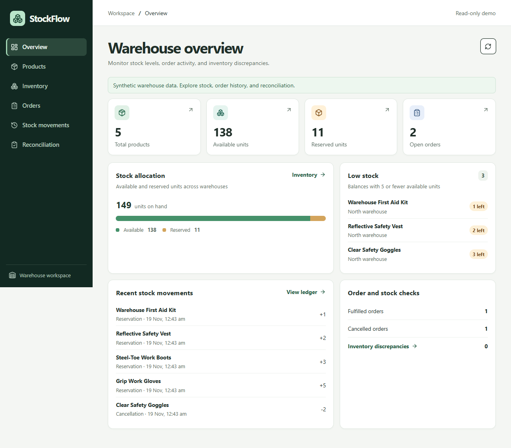
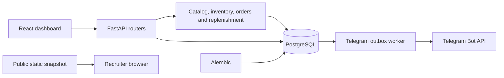

# StockFlow

StockFlow is an inventory and order reliability project for warehouses and small retailers. StockFlow manages its product catalog, inventory receipts, and order lifecycle on PostgreSQL. Its React and TypeScript dashboard connects to the same APIs for warehouse operations, audit history, and reconciliation. Each stock operation commits its balance changes alongside its ledger entries.

## Portfolio demo

[Open the public StockFlow demo](https://stockflow-adn2805.pages.dev/). It runs on Cloudflare Pages Free and displays a fixed synthetic snapshot. Run the local stack for authentication and write operations. See the [deployment runbook](docs/deployment.md) for build and verification steps.



## Architecture



The backend uses Python 3.12, FastAPI, Pydantic, SQLAlchemy 2, psycopg, Alembic, and Uvicorn. Routers handle HTTP responses, services own write transactions, and PostgreSQL enforces uniqueness and inventory bounds. API and PostgreSQL ports bind to loopback in Compose.

### Data model

| Table | Purpose |
| --- | --- |
| `products` | Unique normalized SKU and decimal price stored as `NUMERIC(12,2)` |
| `warehouses` | Named stock locations |
| `inventory` | One row per product and warehouse, with `0 <= reserved <= on_hand` |
| `orders` | Warehouse, customer reference, status, and unique idempotency key |
| `order_items` | One row per order and product, with quantity and decimal price snapshot |
| `stock_movements` | Receipt and order deltas linked to the inventory row |
| `users` / `login_sessions` | Account roles, Argon2id password hashes, and expiring session digests |
| `reorder_policies` / `replenishment_recommendations` | Per-warehouse thresholds and targets, with one active draft or approved recommendation per inventory pair |
| `notification_outbox` | Committed Telegram alerts, worker leases, retry schedules, and delivery status |

A new inventory row starts from zero and receives its first units in the same transaction. Subsequent receipts use a PostgreSQL upsert that adds the incoming quantity to the current row. The movement insert shares that transaction, so a failed movement rolls back the balance update. Available quantity is derived as `on_hand - reserved`. Product prices in API responses are JSON strings to preserve decimal precision.

## Order transactions

Each order uses a single warehouse and contains up to 100 distinct products. Order creation claims the idempotency key, snapshots prices, then locks every affected balance in ascending product ID order. It verifies the entire order before reserving stock. The order, items, balance changes, and movements commit together. A failed transaction rolls all of them back.

The key is unique across orders. Requests sharing a key wait on PostgreSQL while an insert is in progress. If the first attempt commits, an equivalent request returns HTTP 200 and the current order representation. A different payload returns HTTP 409, including after cancellation or fulfillment. The fingerprint uses validated fields with items sorted by product ID, so line order is immaterial. A failed attempt releases its key for a retry.

Cancellation and fulfillment lock the order first, then lock its balances in ascending product ID order. Repeating the same terminal action returns HTTP 200 without another movement. An opposing action returns HTTP 409. These operations use the same stock transaction as the status change.

| Movement | On-hand delta | Reserved delta |
| --- | ---: | ---: |
| Receipt | +quantity | 0 |
| Reservation | 0 | +quantity |
| Cancellation | 0 | -quantity |
| Fulfillment | -quantity | -quantity |

Sum the two delta columns per product and warehouse from the zero opening balances to reconstruct current stock. The Phase 2 migration preserves existing receipts. Downgrading to the Phase 1 schema is blocked once order movements exist, protecting committed stock history.

## Run locally with Docker Compose

Copy `.env.example` to `.env`. Set `POSTGRES_PASSWORD` to a random hex string. Generate it with `python -c "import secrets; print(secrets.token_hex(32))"`. The hexadecimal password can be inserted into the local database URL without encoding. Leave `WRITE_TOKEN` empty to require account credentials for protected operations.

```sh
docker compose up -d --wait db
docker compose run --rm api alembic upgrade head
docker compose up -d api
```

Open Swagger UI at http://localhost:8000/docs. To create a development warehouse, run the following once, then retrieve its ID from `GET /warehouses`.

```sh
docker compose exec db psql -U stockflow -d stockflow -c "INSERT INTO warehouses (name, location) VALUES ('Central', 'Local development') ON CONFLICT (name) DO NOTHING;"
```

For host development with the same PostgreSQL container, create a Python 3.12 virtual environment and install `backend/requirements-dev.txt`. From `backend`, export `DATABASE_URL` using `postgresql+psycopg://stockflow:<password>@127.0.0.1:5432/stockflow` (use the configured port), and provision accounts using the command below. Run `python -m alembic upgrade head` and `python -m uvicorn app.main:app`. Migrations run as a separate command.

## Dashboard and accounts

From the repository root, create accounts interactively with unique passwords of at least 12 characters.

```sh
docker compose run --rm api python -m app.create_user admin-user admin
docker compose run --rm api python -m app.create_user warehouse-staff staff
```

Run the same command with the `guest` role for a named read-only account. Passwords are prompted and stored as Argon2id hashes. Login issues an opaque eight-hour bearer token. PostgreSQL stores its SHA-256 digest and the dashboard keeps the token in memory. Signing out revokes the session. Refreshing the browser clears the local sign-in.

From `frontend`, use Node.js 22.12+ or 24 and run:

```sh
npm ci
npm run dev
```

Open http://127.0.0.1:5173. Vite reads `API_PORT` from the repository root `.env` for the `/api` proxy and defaults to port 8000. Set `STOCKFLOW_API_TARGET` before starting Vite to override the address. A separately hosted frontend can use `VITE_API_BASE` and an explicit comma-separated `CORS_ORIGINS` allowlist on the backend. A production frontend bundle can be built with `npm run build`.

| Capability | Public / guest | Staff | Admin |
| --- | --- | --- | --- |
| View products, warehouses, and inventory | Yes | Yes | Yes |
| Receive stock, process and view orders, inspect audit reports | | Yes | Yes |
| Create and edit products | | | Yes |
| Configure reorder policies, approve recommendations, and view Telegram delivery | | | Yes |

The optional Phase 1 `WRITE_TOKEN` still works as an administrator credential for local automation. Leave it unset when using accounts alone. The API is local by default. Use synthetic customer references for demonstrations.

## API

| Method | Path | Behavior |
| --- | --- | --- |
| GET | `/live` | Check API liveness without connecting to PostgreSQL |
| GET | `/health` | Check database connectivity |
| POST | `/auth/login` | Exchange username and password for a bearer token |
| POST | `/auth/logout` | Revoke the active session |
| GET | `/products` | List products |
| POST | `/products` | Create a product |
| GET | `/products/{product_id}` | Fetch a product |
| PATCH | `/products/{product_id}` | Update supplied product fields |
| GET | `/warehouses` | Discover warehouse IDs |
| GET | `/inventory` | List balances, optionally filtered by `product_id` or `warehouse_id` |
| POST | `/inventory/receipts` | Add a positive integer quantity to a product at a warehouse |
| POST | `/orders` | Reserve stock and snapshot prices |
| GET | `/orders` | List orders and their items |
| GET | `/orders/{order_id}` | Fetch an order |
| POST | `/orders/{order_id}/cancel` | Release a reservation |
| POST | `/orders/{order_id}/fulfill` | Consume reserved stock |
| GET | `/reports/stock-movements` | List recent ledger entries, with optional product and warehouse filters |
| GET | `/reports/reconciliation` | Compare current balances against ledger totals and list discrepancies |
| GET | `/replenishment/policies` | List thresholds and targets |
| PATCH | `/replenishment/policies/{product_id}/{warehouse_id}` | Save a threshold and target |
| GET | `/replenishment/recommendations` | List recommendations and alert delivery status |
| POST | `/replenishment/recommendations/{recommendation_id}/approve` | Record approval without creating a purchase or changing stock |

Order creation requires an `Idempotency-Key` header with 1–128 ASCII letters, digits, or the characters `._:-`. Example JSON body: `{"customer_reference":"demo-123","warehouse_id":1,"items":[{"product_id":1,"quantity":2}]}`. Use synthetic customer references for local demonstrations.

Request bodies are limited to 32 KiB. Lists accept `limit` (1–100, default 50) and `offset` (default 0). Protected endpoints require `Authorization: Bearer <access_token>`, which can be entered in Swagger's **Authorize** dialog. A receipt accepts `{"product_id": 1, "warehouse_id": 1, "quantity": 10}`. A repeated receipt request records another receipt.

## Tests

Install `backend/requirements-dev.txt` and create a dedicated local test database.

```sh
docker compose exec db createdb -U stockflow stockflow_test
```

Export `TEST_DATABASE_URL` as a psycopg URL pointing to that database. From `backend`, run `python -m pytest -ra`. Each PostgreSQL test migrates an empty, randomly named schema and removes it afterward. The test database name must end in `_test`. With the variable unset, database tests are reported as skipped and request validation and authorization tests still run.

Reconciliation uses a single SQL statement so ledger totals and balances come from the same PostgreSQL snapshot. It reports expected and actual quantities without modifying stock. The tests inject discrepancies only into isolated schemas.

To run the browser smoke tests, keep the same `TEST_DATABASE_URL` and run the following from `frontend`. In Windows environments with Microsoft Edge installed, set `STOCKFLOW_BROWSER=msedge` to use it and skip the browser download. If Python is outside your PATH, set `STOCKFLOW_TEST_PYTHON` to the backend virtual environment's Python executable.

```sh
npx playwright install chromium
npm test
```

The browser tests start their own API and dashboard on loopback ports 58081 and 55173. They generate their own account passwords and remove their test schema afterward. The dashboard fetches paginated API results for its overview totals.

## Replenishment and Telegram

Administrators configure a threshold and target for each product and warehouse. When available stock goes below the threshold, PostgreSQL opens a recommendation for the difference between the target and available stock and queues one alert. The draft, outbox entry, and balance change commit together. An independent worker sends Telegram notifications after commit. Approvals record a decision without purchasing stock. Recovering to the threshold closes the recommendation and suppresses pending retries.

Configure `TELEGRAM_BOT_TOKEN` and `TELEGRAM_CHAT_ID` in the private worker environment. Run `docker compose run --rm --build telegram-worker` from the repository root. To check outbox connectivity without sending, append `python -m app.telegram_worker --check-db`. The worker should use Compose's internal database address. See [Telegram setup and troubleshooting](docs/replenishment.md).

The earlier live verification received Telegram HTTP 200 with `ok: true`; the single test outbox row reached `sent` on its first attempt. Automated tests mock Telegram. A lost response after Telegram accepts a message can still cause a duplicate on retry. Delivery status updates are visible when the dashboard refreshes. The public Pages snapshot has no worker, credentials, or connection to the private database.

## Concurrency and performance

The Phase 6 pre-release run used `python benchmarks/concurrency.py` against isolated PostgreSQL 17.12 databases. Two 500-request bursts each returned 100 created orders and 400 insufficient-stock conflicts, taking 9.5151 s and 21.3474 s. The 32-request multi-product run returned 5 created orders and 27 conflicts. The 32-request same-key run created one order and replayed it 31 times. All four scenarios finished with zero invalid balances, ledger or reservation discrepancies, and duplicate keys. See the [benchmark report](benchmarks/README.md) for reproduction commands, measurement limits, and the historical Phase 4 Locust results.

The [CI workflow](.github/workflows/ci.yml) runs PostgreSQL regression tests, the HTTP concurrency harness, the dashboard build, and Playwright smoke tests. The Locust matrix runs locally to keep the timing conditions under the operator's control.
