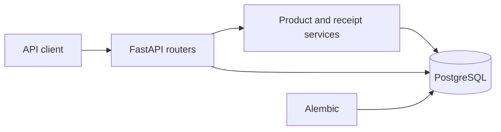

# StockFlow

StockFlow is an inventory and order reliability project for warehouses and small retailers. StockFlow manages its product catalog, inventory receipts, and order lifecycle on PostgreSQL. Each stock operation commits its balance changes alongside its ledger entries.

## Architecture



The backend uses Python 3.12, FastAPI, Pydantic, SQLAlchemy 2, psycopg, Alembic, and Uvicorn. Routers handle HTTP responses, services own write transactions, and PostgreSQL enforces uniqueness and inventory bounds. API and PostgreSQL ports bind to loopback in Compose.

### Data model

| Table | Purpose |
| --- | --- |
| `products` | Unique normalized SKU and decimal price stored as `NUMERIC(12,2)` |
| `warehouses` | Named stock locations |
| `inventory` | One row per product and warehouse, with `0 <= reserved <= on_hand` |
| `orders` | Warehouse, customer reference, status, and unique idempotency key |
| `order_items` | One row per order and product, with quantity and decimal price snapshot |
| `stock_movements` | Receipt and order deltas linked to the inventory row |

A new inventory row starts from zero and receives its first units in the same transaction. Subsequent receipts use a PostgreSQL upsert that adds the incoming quantity to the current row. The movement insert shares that transaction, so a failed movement rolls back the balance update. Available quantity is derived as `on_hand - reserved`. Product prices in API responses are JSON strings to preserve decimal precision.

## Order transactions

Each order uses a single warehouse and contains up to 100 distinct products. Order creation claims the idempotency key, snapshots prices, then locks every affected balance in ascending product ID order. It verifies the entire order before reserving stock. The order, items, balance changes, and movements commit together. A failed transaction rolls all of them back.

The key is unique across orders. Requests sharing a key wait on PostgreSQL while an insert is in progress. If the first attempt commits, an equivalent request returns HTTP 200 and the current order representation. A different payload returns HTTP 409, including after cancellation or fulfillment. The fingerprint uses validated fields with items sorted by product ID, so line order is immaterial. A failed attempt releases its key for a retry.

Cancellation and fulfillment lock the order first, then lock its balances in ascending product ID order. Repeating the same terminal action returns HTTP 200 without another movement. An opposing action returns HTTP 409. These operations use the same stock transaction as the status change.

| Movement | On-hand delta | Reserved delta |
| --- | ---: | ---: |
| Receipt | +quantity | 0 |
| Reservation | 0 | +quantity |
| Cancellation | 0 | -quantity |
| Fulfillment | -quantity | -quantity |

Sum the two delta columns per product and warehouse from the zero opening balances to reconstruct current stock. The Phase 2 migration preserves existing receipts. Downgrading to the Phase 1 schema is blocked once order movements exist, protecting committed stock history.

## Run locally with Docker Compose

Copy `.env.example` to `.env`. Set `POSTGRES_PASSWORD` and `WRITE_TOKEN` to distinct random hex strings. Generate each separately with `python -c "import secrets; print(secrets.token_hex(32))"`. The hexadecimal password can be inserted into the local database URL without encoding. Leave the token empty to disable writes.

```sh
docker compose up -d --wait db
docker compose run --rm api alembic upgrade head
docker compose up -d api
```

Open Swagger UI at http://localhost:8000/docs. To create a development warehouse, run the following once, then retrieve its ID from `GET /warehouses`.

```sh
docker compose exec db psql -U stockflow -d stockflow -c "INSERT INTO warehouses (name, location) VALUES ('Central', 'Local development') ON CONFLICT (name) DO NOTHING;"
```

For host development with the same PostgreSQL container, create a Python 3.12 virtual environment and install `backend/requirements-dev.txt`. From `backend`, export `DATABASE_URL` using `postgresql+psycopg://stockflow:<password>@127.0.0.1:5432/stockflow` (use the configured port), and export `WRITE_TOKEN` to enable writes. Run `python -m alembic upgrade head` and `python -m uvicorn app.main:app`. Migrations run as a separate command.

## API

| Method | Path | Behavior |
| --- | --- | --- |
| GET | `/health` | Check database connectivity |
| GET | `/products` | List products |
| POST | `/products` | Create a product |
| GET | `/products/{product_id}` | Fetch a product |
| PATCH | `/products/{product_id}` | Update supplied product fields |
| GET | `/warehouses` | Discover warehouse IDs |
| GET | `/inventory` | List balances, optionally filtered by `product_id` or `warehouse_id` |
| POST | `/inventory/receipts` | Add a positive integer quantity to a product at a warehouse |
| POST | `/orders` | Reserve stock and snapshot prices |
| GET | `/orders` | List orders and their items |
| GET | `/orders/{order_id}` | Fetch an order |
| POST | `/orders/{order_id}/cancel` | Release a reservation |
| POST | `/orders/{order_id}/fulfill` | Consume reserved stock |

Order creation requires an `Idempotency-Key` header with 1–128 ASCII letters, digits, or the characters `._:-`. Example JSON body: `{"customer_reference":"demo-123","warehouse_id":1,"items":[{"product_id":1,"quantity":2}]}`. Use synthetic customer references for local demonstrations.

Request bodies are limited to 32 KiB. Lists accept `limit` (1–100, default 50) and `offset` (default 0). Writes require `Authorization: Bearer <WRITE_TOKEN>`, which can be entered in Swagger's **Authorize** dialog. A receipt accepts `{"product_id": 1, "warehouse_id": 1, "quantity": 10}`. A repeated receipt request records another receipt. Use the locally configured token for development only. Account management and role-based access are later milestones.

## Tests

Install `backend/requirements-dev.txt` and create a dedicated local test database.

```sh
docker compose exec db createdb -U stockflow stockflow_test
```

Export `TEST_DATABASE_URL` as a psycopg URL pointing to that database. From `backend`, run `python -m pytest -ra`. Each PostgreSQL test migrates an empty, randomly named schema and removes it afterward. The test database name must end in `_test`. With the variable unset, database tests are reported as skipped and request validation and authorization tests still run.

The next milestone is Phase 3, which covers the dashboard, authentication, stock movement reports, and reconciliation.
