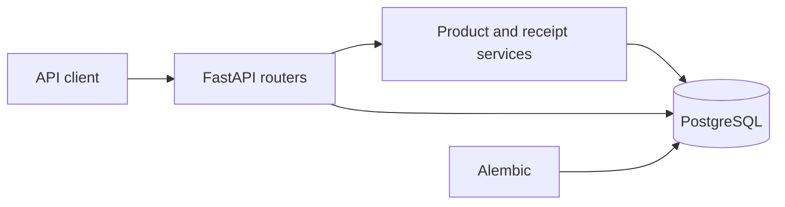

# StockFlow

StockFlow is an inventory and order reliability project for warehouses and small retailers. Phase 1 establishes the product catalog and inventory receipts on PostgreSQL. Each receipt records the increase alongside the new stock balance in a single transaction.

## Architecture



The backend uses Python 3.12, FastAPI, Pydantic, SQLAlchemy 2, psycopg, Alembic, and Uvicorn. Routers handle HTTP responses, services own write transactions, and PostgreSQL enforces uniqueness and inventory bounds. API and PostgreSQL ports bind to loopback in Compose.

### Data model

| Table | Purpose |
| --- | --- |
| `products` | Unique normalized SKU and decimal price stored as `NUMERIC(12,2)` |
| `warehouses` | Named stock locations |
| `inventory` | One row per product and warehouse, with `0 <= reserved <= on_hand` |
| `stock_movements` | Receipt deltas linked to the inventory row |

A new inventory row starts from zero and receives its first units in the same transaction. Subsequent receipts use a PostgreSQL upsert that adds the incoming quantity to the current row. The movement insert shares that transaction, so a failed movement rolls back the balance update. Available quantity is derived as `on_hand - reserved`. Product prices in API responses are JSON strings to preserve decimal precision.

## Run locally with Docker Compose

Copy `.env.example` to `.env`. Set `POSTGRES_PASSWORD` and `WRITE_TOKEN` to distinct random hex strings. Generate each separately with `python -c "import secrets; print(secrets.token_hex(32))"`. The hexadecimal password can be inserted into the local database URL without encoding. Leave the token empty to disable writes.

```sh
docker compose up -d --wait db
docker compose run --rm api alembic upgrade head
docker compose up -d api
```

Open Swagger UI at http://localhost:8000/docs. To create a development warehouse, run the following once, then retrieve its ID from `GET /warehouses`.

```sh
docker compose exec db psql -U stockflow -d stockflow -c "INSERT INTO warehouses (name, location) VALUES ('Central', 'Local development') ON CONFLICT (name) DO NOTHING;"
```

For host development with the same PostgreSQL container, create a Python 3.12 virtual environment and install `backend/requirements-dev.txt`. From `backend`, export `DATABASE_URL` using `postgresql+psycopg://stockflow:<password>@127.0.0.1:5432/stockflow` (use the configured port), and export `WRITE_TOKEN` to enable writes. Run `python -m alembic upgrade head` and `python -m uvicorn app.main:app`. Migrations run as a separate command.

## API

| Method | Path | Behavior |
| --- | --- | --- |
| GET | `/health` | Check database connectivity |
| GET | `/products` | List products |
| POST | `/products` | Create a product |
| GET | `/products/{product_id}` | Fetch a product |
| PATCH | `/products/{product_id}` | Update supplied product fields |
| GET | `/warehouses` | Discover warehouse IDs |
| GET | `/inventory` | List balances, optionally filtered by `product_id` or `warehouse_id` |
| POST | `/inventory/receipts` | Add a positive integer quantity to a product at a warehouse |

Request bodies are limited to 32 KiB. Lists accept `limit` (1–100, default 50) and `offset` (default 0). Writes require `Authorization: Bearer <WRITE_TOKEN>`, which can be entered in Swagger's **Authorize** dialog. A receipt accepts `{"product_id": 1, "warehouse_id": 1, "quantity": 10}`. A repeated receipt request records another receipt. Use the locally configured token for development only. Account management and role-based access are later milestones.

## Tests

Install `backend/requirements-dev.txt` and create a dedicated local test database.

```sh
docker compose exec db createdb -U stockflow stockflow_test
```

Export `TEST_DATABASE_URL` as a psycopg URL pointing to that database. From `backend`, run `python -m pytest -ra`. Each PostgreSQL test migrates an empty, randomly named schema and removes it afterward. The test database name must end in `_test`. With the variable unset, database tests are reported as skipped and request validation and authorization tests still run.

The next milestone is Phase 2, which covers order reservations, idempotency, fulfillment, cancellation, and their transaction and concurrency tests.
